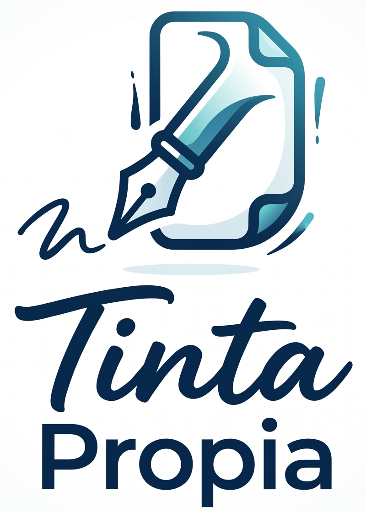
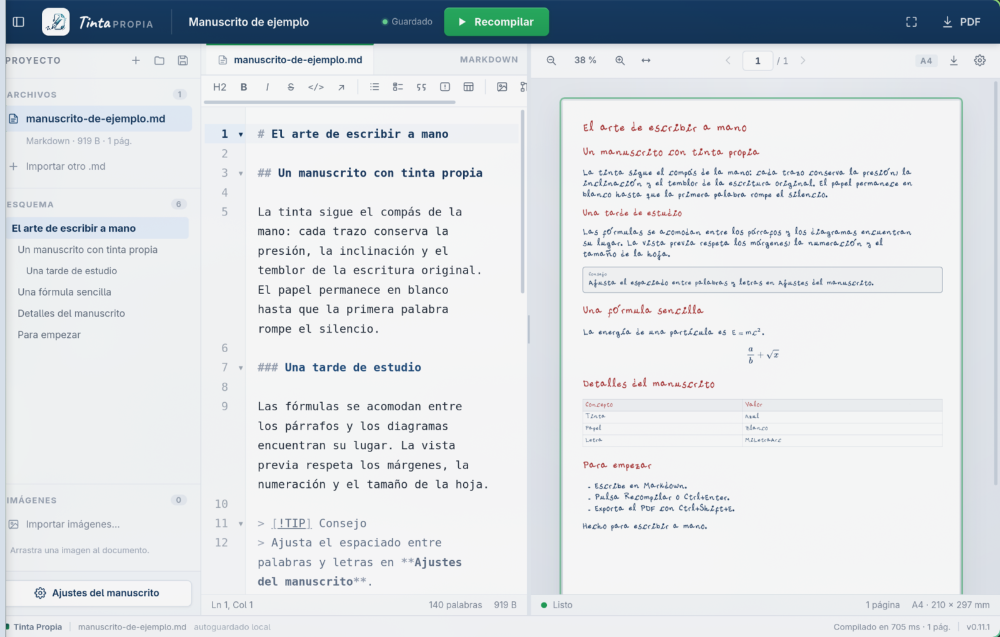

<p align="center">
  
</p>

<h1 align="center">Tinta Propia</h1>

<p align="center">
  <strong>Escribe manuscritos con tu propia letra, sin salir del computador.</strong><br />
  Editor Markdown, vista previa paginada y exportación a PDF. Todo funciona de forma local.
</p>

<p align="center">
  <a href="https://github.com/arc3uz/tinta-propia/releases">
    
  </a>
</p>

<p align="center">
  <a href="https://github.com/arc3uz/tinta-propia/actions/workflows/ci.yml"></a>
  <a href="https://github.com/arc3uz/tinta-propia/releases"></a>
  <a href="LICENSE"></a>
  
  
</p>

<p align="center">
  
</p>

Tinta Propia es una aplicación de escritorio para escribir manuscritos con una letra calibrada. Tiene una interfaz inspirada en Overleaf: archivos y esquema a la izquierda, editor Markdown al centro y vista previa paginada a la derecha.

**100 % local.** No hay cuentas, servidores, telemetría ni conexión a internet. Funciona en **Linux**, **Windows 10/11** y **macOS 11 o superior**.

## Contenido

- [Características](#características)
- [Fuentes incluidas](#fuentes-incluidas)
- [Descargas](#descargas)
- [Primeros pasos](#primeros-pasos)
- [Guía rápida](#guía-rápida)
- [Atajos](#atajos)
- [Compilar](#compilar)
- [Estructura del repositorio](#estructura-del-repositorio)
- [Desarrollo](#desarrollo)
- [Documentación](#documentación)
- [Contribuir](#contribuir)
- [Créditos](#créditos)
- [Licencia](#licencia)

## Características

- **Editor Markdown** con resaltado, números de línea, plegado, búsqueda e historial.
- **Tu letra, calibrada**: fuente propia incluida, 15 fuentes manuscritas adicionales e importación de TTF, OTF y WOFF.
- **Vista previa real** sobre canvas, con títulos rojos, cuerpo azul y papel blanco liso.
- **Fórmulas LaTeX** en línea y en bloque con MathJax local, además de un modo manuscrito simple.
- **Diagramas Mermaid** automáticos, con carga diferida y sin conexión.
- **Hojas y márgenes**: A4, Carta, Legal, A5 y Oficio; cinco tamaños de margen.
- **Mezcla de fuentes** de hasta cuatro manos, por sección o por línea.
- **Tres columnas** horizontales con saltos de hoja y de columna.
- **Imágenes, tablas, callouts y código** con ajuste de tamaño, pie y texto al lado.
- **Biblioteca de proyectos** con carpetas, etiquetas heredadas, buscador, filtros y papelera.
- **Exportación PDF y PNG** por hoja, además de importación de Markdown.
- **Autoguardado y proyectos `.papernotes`** con imágenes incrustadas.
- **Pantalla completa, atajos y tema local**: sin dependencias de servicios externos.

## Fuentes incluidas

La aplicación incluye **16 familias tipográficas** (17 archivos TTF) empaquetadas localmente:

| Familia | Uso | Origen / licencia |
|---|---|---|
| **MiLetraArc** | Fuente calibrada principal | Incluida por el autor |
| **Papernotes** y **Papernotes Bold** | Fuente clásica incluida | Incluida por el autor |
| Caveat, Patrick Hand, Kalam, Shadows Into Light, Indie Flower, Gochi Hand, Sue Ellen Francisco, Over the Rainbow, Annie Use Your Telescope, Gloria Hallelujah, Reenie Beanie, Schoolbell, Grape Nuts y Mynerve | Fuentes manuscritas alternativas | Google Fonts, SIL Open Font License 1.1 |

Están en `src/assets/fonts/` y se declaran en `src/fonts.css`. Los textos completos de las licencias están en [`docs/THIRD_PARTY_NOTICES.md`](docs/THIRD_PARTY_NOTICES.md). La app también permite importar fuentes propias.

Si quieres crear tu propia fuente, usa la [plantilla completa](<docs/plantilla-de-caracteres/Plantilla de caracteres - Tinta Propia.pdf>) o la [plantilla simple de 3 páginas](<docs/plantilla-de-caracteres/Plantilla de caracteres - Tinta Propia - Simple.pdf>). La simple incluye letras, números, español, puntuación y signos básicos, sin griegas ni símbolos avanzados.

## Descargas

La versión más reciente está en **[GitHub Releases](https://github.com/arc3uz/tinta-propia/releases)**.

| Plataforma | Instaladores | Notas |
|---|---|---|
| **Linux** | AppImage, `.deb`, `.rpm` | AppImage recomendado para Arch/CachyOS. |
| **Windows 10/11** | NSIS `.exe`, `.msi` | Incluyen WebView2 en modo offline. |
| **macOS 11+** | DMG universal | Apple Silicon e Intel; firma ad-hoc. |

### Linux

AppImage:

```bash
chmod +x Tinta-Propia_*.AppImage
./Tinta-Propia_*.AppImage
```

El AppImage incluye las bibliotecas que necesita. Los paquetes `.deb` y `.rpm` usan WebKitGTK 4.1 del sistema; instálalo antes de abrirlos.

### Windows

Descarga el `.exe` o el `.msi`. Ambos incluyen WebView2 offline, así que no necesitan internet al instalar. Los instaladores no están firmados digitalmente, así que SmartScreen puede pedir confirmación.

### macOS

Descarga el DMG universal y arrastra **Tinta Propia** a **Applications**. El DMG usa firma ad-hoc y no está notarizado:

1. Haz clic derecho sobre la app → **Abrir**.
2. Si macOS lo bloquea, ve a **System Settings → Privacy & Security → Open Anyway**.
3. También puedes quitar la cuarentena desde Terminal:

```bash
xattr -dr com.apple.quarantine "/Applications/Tinta Propia.app"
```

## Primeros pasos

1. Descarga e instala la versión para tu sistema.
2. Abre la app: aparece la página de **Inicio** para continuar la sesión, crear un proyecto, abrir uno reciente o importar un Markdown.
3. Edita la plantilla, empieza con **Menú → Nuevo proyecto** o importa un `.md` desde **Menú → Importar Markdown**.
4. Ajusta el estilo en **Ajustes del manuscrito**; el tamaño de letra está en **Letra y tinta**.
5. Pulsa **Recompilar** o `Ctrl+Enter`, guarda con `Ctrl+S` y exporta con **PDF** o `Ctrl+Shift+E`.

<details>
<summary><strong>Dónde se guardan los datos</strong></summary>

- **Linux:** `~/.local/share/io.github.arc3uz.tintapropia/`
- **Windows:** `%APPDATA%\io.github.arc3uz.tintapropia\`
- **macOS:** `~/Library/Application Support/io.github.arc3uz.tintapropia/`

Contiene `autosave.json`, `recent.json`, `settings.json` y la carpeta `fonts/`. Puedes abrirla desde **Menú → Abrir carpeta de datos**.

Un proyecto `.papernotes` es un JSON con el documento, los ajustes y las imágenes incrustadas. Si exportas Markdown plano, las imágenes quedan como tokens `[[IMG:n]]`; para conservarlas usa el proyecto o el PDF.

Si vienes de **Papernotes Studio**, la carpeta cambió de `cl.uchile.papernotes.studio` a `io.github.arc3uz.tintapropia`. Copia `autosave.json`, `settings.json`, `recent.json` y `fonts/` si quieres conservar la sesión.

</details>

<details>
<summary><strong>Biblioteca de proyectos</strong></summary>

- **Inicio** lista los proyectos en un árbol de carpetas. Puedes buscar por título o etiqueta, filtrar por etiqueta, ordenar por nombre o fecha y crear carpetas.
- Cada proyecto admite varias etiquetas separadas por comas. Las carpetas también se etiquetan y sus proyectos heredan automáticamente las etiquetas de las carpetas padre.
- Con clic derecho sobre una carpeta aparece **Nuevo proyecto aquí**; también puedes crear carpetas y gestionar etiquetas desde el menú contextual.
- **Guardar como** usa el diálogo nativo del sistema y propone la biblioteca de la app. **Mover a otra ubicación…** permite sacar un proyecto de la biblioteca.
- Los proyectos fuera de la biblioteca aparecen en **Recientes fuera de la biblioteca**. Las etiquetas se guardan dentro del `.papernotes` y viajan con el archivo.

</details>

## Guía rápida

| Quiero… | Cómo |
|---|---|
| Escribir una fórmula | `$...$` en línea o `$$...$$` en bloque; en **Ajustes → Fórmulas** eliges el modo. |
| Insertar una imagen | **Menú → Imagen** o el token `[[IMG:1]]`. |
| Poner texto al lado de una imagen | `[[IMG:1\|right\|Pie]]`. |
| Mezclar letras | **Ajustes → Letra y tinta → Mezclar manos**. |
| Usar tres columnas | **Ajustes → Hoja → 3 columnas**; usa `[[PAGEBREAK]]` y `[[COLUMNBREAK]]`. |
| Crear un diagrama | Un bloque de código `mermaid`; se renderiza solo. |
| Añadir tablas o callouts | Markdown estándar y `> [!TIP]`. |

### Fórmulas

```markdown
La probabilidad es $P(A \mid B)$.

$$
H(X) = -\sum_{i=1}^{n} p_i \log_2 p_i
$$
```

En **Ajustes del manuscrito → Fórmulas** puedes elegir:

- **Mixto:** fórmulas en línea con tu letra y bloques con MathJax. Es el modo recomendado.
- **Tipográficas:** todo se renderiza con MathJax.
- **Manuscritas:** todo se convierte a una versión simple con tu letra.

MathJax viaja dentro de la aplicación, así que las fórmulas funcionan sin internet y aparecen en el PDF. El botón **ƒx** abre el cuadro para insertar una fórmula.

### Mezcla de fuentes y columnas

- La mezcla admite una fuente principal y hasta tres secundarias, por sección o por línea, con intensidad de 0 a 100 %.
- En tres columnas, `[[PAGEBREAK]]` empieza una hoja nueva y `[[COLUMNBREAK]]` pasa a la siguiente columna.
- La numeración cuenta hojas, no columnas; el PDF y la impresión salen en horizontal.

## Atajos

| Atajo | Acción |
|---|---|
| `Ctrl+Enter` | Recompilar |
| `Ctrl+S` | Guardar |
| `Ctrl+Shift+S` | Guardar como |
| `Ctrl+O` | Abrir proyecto |
| `Ctrl+N` | Nuevo proyecto |
| `Ctrl+,` | Ajustes |
| `Ctrl+\` | Mostrar u ocultar el panel lateral |
| `Ctrl+B` / `Ctrl+I` / `Ctrl+E` | Negrita / cursiva / código |
| `Ctrl+F` | Buscar en el editor |
| `Ctrl+Shift+E` | Exportar PDF |
| `Ctrl+Q` | Salir (guarda la sesión) |
| `Esc` | Cerrar menús y ventanas |

En macOS, los atajos aceptan `Cmd` además de `Ctrl`.

## Compilar

### Requisitos

- Node.js 20 o superior (recomendado 22, ver `.nvmrc`).
- Rust estable con `rustup`.
- Git.

<details>
<summary><strong>Requisitos por plataforma</strong></summary>

**Linux:** WebKitGTK 4.1, GTK 3, libsoup 3 y herramientas de compilación.

```bash
# Arch / CachyOS
sudo pacman -S webkit2gtk-4.1 gtk3 librsvg base-devel

# Ubuntu / Debian
sudo apt install libwebkit2gtk-4.1-dev build-essential curl wget file \
  libxdo-dev libssl-dev libayatana-appindicator3-dev librsvg2-dev \
  patchelf rpm
```

**Windows:** Visual Studio Build Tools con **Desarrollo para escritorio con C++**, WebView2 y Rust con el toolchain `stable-x86_64-pc-windows-msvc`.

**macOS:** Xcode Command Line Tools y los dos objetivos de Rust:

```bash
xcode-select --install
rustup target add aarch64-apple-darwin x86_64-apple-darwin
```

</details>

### Probar en desarrollo

```bash
git clone https://github.com/arc3uz/tinta-propia.git
cd tinta-propia
npm ci
npm run app:dev
```

Para probar solo la interfaz en el navegador:

```bash
npm run dev
```

### Instaladores

```bash
npm run app:build
```

| Sistema | Formatos | Salida |
|---|---|---|
| Linux | AppImage, `.deb`, `.rpm` | `src-tauri/target/release/bundle/` |
| Windows | NSIS `.exe`, `.msi` | `src-tauri\target\release\bundle\` |
| macOS | DMG universal | `src-tauri/target/universal-apple-darwin/release/bundle/dmg/` |

No se puede compilar para Windows ni macOS desde Linux: cada workflow usa su propio runner. En macOS, el DMG se firma en modo ad-hoc y no se notariza.

### Scripts

```text
npm run dev           Vite en el navegador
npm run build         build del frontend
npm run app:dev       Tauri en desarrollo
npm run app:build     instaladores de la plataforma actual
npm run format        cargo fmt
npm run lint          cargo clippy con -D warnings
npm run test:rust     cargo test de la librería
npm run check         build + pruebas Rust
npm run version:bump  sincroniza la versión en package.json, Cargo.toml y tauri.conf.json
```

## Estructura del repositorio

<details>
<summary><strong>Ver árbol del proyecto</strong></summary>

```text
src/
  main.js       orquestador: arranque, editor, compilación, proyectos y ajustes
  engine.js     motor canvas: texto, párrafos, tablas, callouts, código, imágenes
  editor.js     CodeMirror 6 y tema del editor
  mermaid.js    render de Mermaid a imagen
  math.js       fórmulas MathJax y modo manuscrito
  styles.css    interfaz tipo Overleaf
  fonts.css     fuentes locales
  assets/
    brand/icon.png
    example.md
    fonts/      17 TTF: MiLetraArc, Papernotes y 14 fuentes manuscritas
  core/
    state.js    estado compartido y claves de persistencia
    utils.js    utilidades de DOM, formato y archivos
    modal.js    modales, avisos, confirmaciones y progreso
  features/
    library.js  inicio, biblioteca, etiquetas y carpetas
    formulas.js paleta rápida de fórmulas
    export.js   exportación PDF, PNG y Markdown
    outline.js  esquema y estadísticas

public/mathjax/
  tex-svg.js    MathJax 3.2.2 local

src-tauri/
  src/lib.rs        comandos Tauri
  src/storage.rs    autosave, recientes, escritura atómica
  src/fonts.rs      importación y listado de fuentes
  src/pdf.rs        generación de PDF con JPEG embebidos
  capabilities/default.json
  tauri.conf.json
  tauri.linux.conf.json
  tauri.windows.conf.json
  tauri.macos.conf.json
  icons/

scripts/
  bump-version.mjs  actualización de versión

docs/
  ARCHITECTURE.md
  RELEASING.md
  THIRD_PARTY_NOTICES.md
  branding/
    logo.png
    screenshot.png
  plantilla-de-caracteres/
    README.md
    Plantilla de caracteres - Tinta Propia.html
    Plantilla de caracteres - Tinta Propia.pdf
    Plantilla de caracteres - Tinta Propia - Simple.html
    Plantilla de caracteres - Tinta Propia - Simple.pdf

.github/
  CONTRIBUTING.md
  CODE_OF_CONDUCT.md
  SECURITY.md
  dependabot.yml
  pull_request_template.md
  ISSUE_TEMPLATE/
  workflows/
    ci.yml
    cleanup.yml
    release.yml
```

</details>

La arquitectura y el flujo de compilación están documentados en [`docs/ARCHITECTURE.md`](docs/ARCHITECTURE.md).

## Desarrollo

El proyecto usa tres workflows de GitHub Actions:

- **CI** ejecuta formato, Clippy, pruebas Rust y build del frontend; los instaladores se generan solo en ejecuciones manuales con la casilla **Generar instaladores**.
- **Release** compila Linux, Windows y macOS al empujar un tag `v*` y crea un **draft release**.
- **Limpieza** borra artefactos antiguos de Actions para no agotar la cuota de 2 GB.

Los detalles para mantener y publicar versiones están en [`docs/RELEASING.md`](docs/RELEASING.md).

## Documentación

- [Guía de la plantilla de caracteres](<docs/plantilla-de-caracteres/README.md>)
- [Plantilla completa para fuentes](<docs/plantilla-de-caracteres/Plantilla de caracteres - Tinta Propia.pdf>)
- [Plantilla simple (3 páginas)](<docs/plantilla-de-caracteres/Plantilla de caracteres - Tinta Propia - Simple.pdf>)
- [Arquitectura del frontend](docs/ARCHITECTURE.md)
- [Publicar una versión](docs/RELEASING.md)
- [Avisos de terceros y licencias](docs/THIRD_PARTY_NOTICES.md)
- [Historial de cambios](CHANGELOG.md)
- [Guía de contribución](.github/CONTRIBUTING.md)
- [Política de seguridad](.github/SECURITY.md)

<details>
<summary><strong>Notas y límites</strong></summary>

- El motor de dibujo es JavaScript sobre canvas; el mismo código produce las mismas páginas en WebKitGTK, WebView2 y WKWebView.
- El PDF se rasteriza a 1,5× el tamaño del canvas y se arma en Rust con JPEG embebidos, sin depender del motor de impresión del sistema.
- La exportación se bloquea mientras hay diagramas Mermaid en preparación para no generar un PDF con recuadros pendientes.
- La primera compilación con muchos diagramas Mermaid puede tardar; después se reutiliza la caché en memoria.
- En modo manuscrito, las fracciones y raíces se simplifican; las fórmulas dentro de tablas y bloques de código se muestran como texto.
- Las fórmulas manuscritas usan la fuente principal aunque la mezcla de fuentes esté activa.
- Las imágenes se guardan como data URLs dentro del proyecto: un proyecto con muchas fotos puede pesar varios MB.
- En el navegador, las fuentes importadas y los proyectos dependen de `localStorage`.
- Los instaladores no están firmados digitalmente. Windows SmartScreen y macOS Gatekeeper pueden pedir confirmación.

</details>

## Contribuir

Las contribuciones son bienvenidas. Antes de abrir un pull request, lee la [guía de contribución](.github/CONTRIBUTING.md) y el [código de conducta](.github/CODE_OF_CONDUCT.md).

Si encuentras una vulnerabilidad, sigue la [política de seguridad](.github/SECURITY.md) en vez de abrir un issue público.

## Créditos

- Motor de manuscrito y fuentes originales: herramienta **Manuscrito Papernotes**.
- [Tauri 2](https://tauri.app/), [Rust](https://www.rust-lang.org/), [CodeMirror 6](https://codemirror.net/), [MathJax](https://www.mathjax.org/) y [Mermaid](https://mermaid.js.org/).
- Fuentes de Google Fonts bajo SIL Open Font License 1.1. Ver [avisos de terceros](docs/THIRD_PARTY_NOTICES.md).

Hecho para escribir a mano.

## Licencia

Tinta Propia se distribuye bajo la [licencia MIT](LICENSE).
