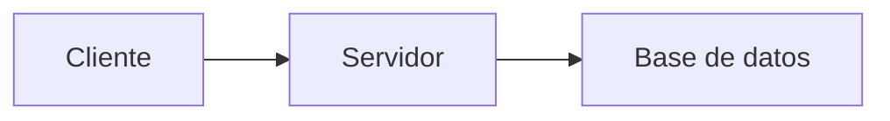

<p align="center">
  
</p>

# Tinta Propia

[](https://github.com/arc3uz/tinta-propia/actions/workflows/ci.yml)
[](LICENSE)

Aplicación de escritorio para escribir manuscritos con tu propia letra, con una interfaz inspirada en Overleaf: panel de archivos y esquema a la izquierda, editor Markdown al centro y vista previa paginada a la derecha.

Funciona **100 % local**. No hay cuentas, servidores, telemetría ni conexión a internet.

El proyecto está preparado para compilar en **Linux** (AppImage, `.deb`, `.rpm`) y en **Windows 10/11** (instalador NSIS y MSI con WebView2 offline).

## Características

- Editor Markdown con resaltado de sintaxis, números de línea, plegado, búsqueda e historial.
- Vista previa real del manuscrito sobre canvas, con la fuente `MiLetra IIC2531`.
- Tamaños de hoja A4, Carta, Legal, A5 y Oficio.
- Espaciado entre palabras y letras ajustable; tinta, márgenes, realismo, temblor, presión, inclinación y semilla.
- Títulos rojos y cuerpo azul sobre papel blanco liso, sin cuadrícula ni margen rojo.
- Diagramas Mermaid renderizados automáticamente en segundo plano.
- Tablas, callouts, listas, citas, código en cajas y saltos de página.
- Imágenes insertadas con tokens `[[IMG:n]]` y guardadas dentro del proyecto.
- Índice con números de página automáticos.
- Proyectos `.papernotes`, autoguardado y restauración de sesión.
- Exportación PDF nativa con Rust y exportación PNG por página.
- Importación de Markdown y de fuentes TTF/OTF/WOFF.
- Proyectos recientes y carpeta de datos accesible desde el menú.
- Atajos de teclado y cierre con `Ctrl+Q` guardando la sesión.

## Requisitos

### General

- Node.js 20 o superior (recomendado 22, ver `.nvmrc`).
- Rust estable con `rustup`.
- Git.

### Linux

WebKitGTK 4.1, GTK 3, libsoup 3 y herramientas de compilación.

En Arch / CachyOS:

```bash
sudo pacman -S webkit2gtk-4.1 gtk3 librsvg base-devel
```

En Ubuntu / Debian:

```bash
sudo apt install libwebkit2gtk-4.1-dev build-essential curl wget file \
  libxdo-dev libssl-dev libayatana-appindicator3-dev librsvg2-dev \
  patchelf rpm
```

### Windows

- Windows 10/11.
- Microsoft Visual Studio Build Tools con la carga de trabajo **Desarrollo para escritorio con C++**.
- WebView2. Windows 10/11 suele incluirlo; si no, el instalador lo incorpora en modo offline.
- Rust con el toolchain `stable-x86_64-pc-windows-msvc`.

## Desarrollo

```bash
git clone https://github.com/arc3uz/tinta-propia.git
cd tinta-propia
npm ci
npm run app:dev
```

Esto levanta Vite en `http://localhost:1420` y abre la ventana de Tauri.

Para probar solo la interfaz en el navegador:

```bash
npm run dev
```

En el navegador el guardado usa `localStorage` y la exportación PDF usa el diálogo de impresión. Las funciones nativas (proyectos, fuentes y PDF por Rust) requieren la app Tauri.

## Compilar

### Linux

```bash
npm run app:build
```

Genera AppImage, `.deb` y `.rpm` en:

```text
src-tauri/target/release/bundle/
```

### Windows

En PowerShell:

```powershell
npm ci
npm run app:build
```

Genera un instalador NSIS (`.exe`) y un MSI en:

```text
src-tauri\target\release\bundle\
```

El instalador de Windows usa **WebView2 offline**, así que no necesita internet al instalar. Por eso pesa más que un instalador normal.

### Solo el binario

```bash
npm run app:build -- --no-bundle
```

El ejecutable queda en `src-tauri/target/release/tinta-propia` (Linux) o `tinta-propia.exe` (Windows).

No se recomienda compilar para Windows desde Linux ni al revés. Los workflows de GitHub Actions compilan cada sistema en su propio runner.

## Salidas por plataforma

| Sistema | Formatos | Notas |
|---|---|---|
| Linux | AppImage, `.deb`, `.rpm` | AppImage recomendado para CachyOS/Arch |
| Windows | NSIS `.exe`, `.msi` | WebView2 offline incluido |

## Scripts

```text
npm run dev           Vite en el navegador
npm run build         build del frontend
npm run app:dev       Tauri en desarrollo
npm run app:build     instaladores de la plataforma actual
npm run format        cargo fmt
npm run lint          cargo clippy con -D warnings
npm run test:rust     cargo test de la librería
npm run check         build + pruebas Rust
npm run version:bump  sincroniza la versión en package.json, Cargo.toml y tauri.conf.json
```

Para regenerar los iconos de la aplicación a partir del logo:

```bash
npx tauri icon src/assets/brand/icon.png -o src-tauri/icons
```

## CI y releases

El repositorio incluye dos workflows:

- `.github/workflows/ci.yml`
  - En pull requests ejecuta formato, Clippy, pruebas Rust y build del frontend.
  - En pushes a `main` y ejecuciones manuales también genera instaladores de Linux y Windows como artefactos.
- `.github/workflows/release.yml`
  - Se activa al empujar un tag `v*`.
  - Compila en Ubuntu y Windows.
  - Publica un **draft release** con AppImage, `.deb`, `.rpm`, `.exe` y `.msi`.

### Publicar una versión

1. Actualiza la versión en todos los archivos:

   ```bash
   npm run version:bump -- 0.2.0
   cargo check --manifest-path src-tauri/Cargo.toml
   ```

2. Haz commit:

   ```bash
   git add .
   git commit -m "chore: versión 0.2.0"
   git push origin main
   ```

3. Crea el tag y súbelo:

   ```bash
   git tag v0.2.0
   git push origin v0.2.0
   ```

4. Revisa el draft release en GitHub y publícalo.

## Linux y Windows: notas de compatibilidad

- El motor de dibujo es JavaScript sobre canvas; el mismo código produce las mismas páginas en WebKitGTK y WebView2.
- Los diálogos nativos, la carpeta de datos y la apertura de archivos usan Tauri; las rutas se resuelven con `Path` de Rust.
- El PDF se arma en Rust con imágenes JPEG embebidas, sin depender del motor de impresión del sistema.
- La exportación se bloquea mientras hay diagramas Mermaid en preparación para no generar un PDF con recuadros pendientes.
- La fuente calibrada y las 16 fuentes incluidas viajan dentro del frontend; no se descargan desde internet.
- En Windows, el instalador incluye WebView2 offline. En Linux, el AppImage incluye las bibliotecas que necesita; el `.deb` y el `.rpm` usan WebKitGTK del sistema.

## Uso rápido

1. Abre la app: la primera vez carga el resumen compacto como documento de ejemplo.
2. Escribe o importa un `.md` desde **Menú → Importar Markdown**.
3. Ajusta el estilo en **Ajustes del manuscrito**; el espaciado entre palabras está arriba.
4. Pulsa **Recompilar** o `Ctrl+Enter`.
5. Guarda con `Ctrl+S` como proyecto `.papernotes`.
6. Exporta el PDF con **PDF** o `Ctrl+Shift+E`.

## Atajos

| Acción | Atajo |
|---|---|
| Recompilar | `Ctrl+Enter` |
| Guardar | `Ctrl+S` |
| Guardar como | `Ctrl+Shift+S` |
| Abrir proyecto | `Ctrl+O` |
| Nuevo proyecto | `Ctrl+N` |
| Ajustes | `Ctrl+,` |
| Mostrar u ocultar panel | `Ctrl+\` |
| Negrita / cursiva / código | `Ctrl+B` / `Ctrl+I` / `Ctrl+E` |
| Buscar | `Ctrl+F` |
| Exportar PDF | `Ctrl+Shift+E` |
| Salir | `Ctrl+Q` |

## Dónde se guardan los datos

La app usa la carpeta de datos de Tauri según el sistema:

- Linux: `~/.local/share/io.github.arc3uz.tintapropia/`
- Windows: `%APPDATA%\io.github.arc3uz.tintapropia\`
- macOS: `~/Library/Application Support/io.github.arc3uz.tintapropia/`

Dentro están:

```text
autosave.json     sesión actual
recent.json       proyectos recientes
settings.json     ajustes globales
fonts/            fuentes importadas
projects/         carpeta sugerida para proyectos
```

El menú **Abrir carpeta de datos** lleva directo a esa ubicación.

Si vienes de la versión anterior (`Papernotes Studio`), la carpeta cambió de `cl.uchile.papernotes.studio` a `io.github.arc3uz.tintapropia`. Puedes copiar `autosave.json`, `settings.json`, `recent.json` y la carpeta `fonts/` a la nueva ubicación. Los proyectos `.papernotes` se abren sin cambios.

## Formato de proyecto

Un `.papernotes` es un JSON legible:

```json
{
  "version": 1,
  "title": "Resumen I2 — Compacto",
  "path": "/ruta/al/proyecto.papernotes",
  "document": "# Título\n\nTexto…",
  "settings": { "font": "MiLetra IIC2531", "pageSize": "a4" },
  "assets": {
    "1": { "data": "data:image/png;base64,…", "displayW": 800 }
  },
  "imageSeq": 1,
  "updatedAt": 1760000000000
}
```

La extensión `.papernotes` se mantiene por compatibilidad con los proyectos creados antes del cambio de nombre. El contenido y el formato son exactamente los mismos.

Al exportar Markdown plano, las imágenes no se incluyen: quedan como tokens `[[IMG:n]]`. Para conservarlas hay que guardar el proyecto `.papernotes` o exportar el PDF.

## Mermaid

Los bloques se escriben directamente en el documento:

````markdown

````

La app los detecta, los renderiza con el tema `redux-color` y los sustituye solo en la vista previa. El código fuente **no se modifica**, así que puedes seguir editándolos.

En el primer arranque los diagramas se preparan en segundo plano para que el documento aparezca de inmediato. Mientras tanto se muestra un recuadro azul “Diagrama en preparación”. Si un diagrama tiene un error de sintaxis, aparece un recuadro rojo y un aviso.

## Arquitectura

```text
src/
  main.js       interfaz, estado, guardado, atajos, diálogos y exportación
  engine.js     motor canvas: texto, párrafos, tablas, callouts, código, imágenes
  editor.js     CodeMirror 6 y tema del editor
  mermaid.js    render de Mermaid a imagen
  styles.css    interfaz tipo Overleaf
  fonts.css     fuentes locales
  assets/       fuente calibrada, fuentes incluidas y documento inicial
  assets/starter.md

src-tauri/
  src/lib.rs        comandos Tauri
  src/storage.rs    autosave, recientes, escritura atómica
  src/fonts.rs      importación y listado de fuentes
  src/pdf.rs        generación de PDF con JPEG embebidos
  tauri.conf.json
  tauri.linux.conf.json
  tauri.windows.conf.json
  icons/

docs/
  branding/
    logo.png
  THIRD_PARTY_NOTICES.md

.github/
  CONTRIBUTING.md
  CODE_OF_CONDUCT.md
  SECURITY.md
  dependabot.yml
  pull_request_template.md
  ISSUE_TEMPLATE/
  workflows/
    ci.yml
    release.yml
```

El render del manuscrito sigue siendo JavaScript sobre canvas. Rust se encarga de archivos, fuentes, diálogos, autosave y PDF. Mermaid también sigue en JavaScript dentro del webview.

## Notas y límites

- El PDF se rasteriza a 1,5× el tamaño del canvas. Un documento de 59 páginas ronda los 25 MB.
- La primera compilación de un documento con muchos diagramas Mermaid puede tardar; el resto usa la caché en memoria.
- Las imágenes se guardan como data URLs dentro del proyecto: un proyecto con muchas fotos puede pesar varios MB.
- El tamaño de hoja afecta al canvas, a la vista previa y al PDF.
- Los instaladores no están firmados digitalmente. Windows SmartScreen puede pedir confirmación; Linux puede pedir marcar el AppImage como ejecutable.
- En el navegador, las fuentes importadas y los proyectos solo duran la sesión o dependen de `localStorage`.

## Créditos

- Aplicación: Tinta Propia.
- Motor de manuscrito y fuentes originales: herramienta `Manuscrito Papernotes.html`.
- Fuente calibrada: `MiLetra IIC2531.ttf`.
- Mermaid 12.3.0, CodeMirror 6, Tauri 2 y Rust.

## Documentación

- [Guía de contribución](.github/CONTRIBUTING.md)
- [Código de conducta](.github/CODE_OF_CONDUCT.md)
- [Política de seguridad](.github/SECURITY.md)
- [Historial de cambios](CHANGELOG.md)
- [Avisos de terceros y licencias de fuentes](docs/THIRD_PARTY_NOTICES.md)
- [Licencia MIT](LICENSE)

## Licencia

MIT. Ver [`LICENSE`](LICENSE).
