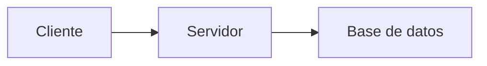

<p align="center">
  
</p>

# Tinta Propia

[](https://github.com/arc3uz/tinta-propia/actions/workflows/ci.yml)
[](LICENSE)

Aplicación de escritorio para escribir manuscritos con tu propia letra, con una interfaz inspirada en Overleaf: panel de archivos y esquema a la izquierda, editor Markdown al centro y vista previa paginada a la derecha.

Funciona **100 % local**. No hay cuentas, servidores, telemetría ni conexión a internet.

El proyecto está preparado para compilar en **Linux** (AppImage, `.deb`, `.rpm`) y en **Windows 10/11** (instalador NSIS y MSI con WebView2 offline).

## Características

- Editor Markdown con resaltado de sintaxis, números de línea, plegado, búsqueda e historial.
- Distribución inicial 50/50 entre editor y vista previa, ajustable con el separador.
- Vista previa real del manuscrito sobre canvas, con la fuente calibrada incluida.
- Tamaños de hoja A4, Carta, Legal, A5 y Oficio.
- Márgenes: **Ninguno (0,1 cm)**, muy pequeños, pequeños, normales y amplios.
- Espaciado entre palabras y letras ajustable; tinta, márgenes, realismo, temblor, presión, inclinación y semilla.
- Títulos rojos y cuerpo azul sobre papel blanco liso, sin cuadrícula ni margen rojo.
- Diagramas Mermaid renderizados automáticamente en segundo plano.
- Fórmulas LaTeX con MathJax y modo manuscrito simple; MathJax se carga solo cuando hace falta.
- Paleta de fórmulas frecuentes con inserción rápida y atajo `Ctrl+Shift+F`.
- Mezcla configurable de hasta cuatro fuentes manuscritas.
- Diseño de hoja en una columna o en **3 columnas horizontales**.
- Tablas, callouts, listas, citas, código en cajas, saltos de página y de columna.
- Imágenes redimensionables, con pie y disposición imagen + texto al lado.
- Biblioteca de imágenes en el panel lateral para arrastrarlas al documento.
- Imágenes guardadas dentro del proyecto y editables con **Ajustar imagen**.
- Índice con números de página automáticos.
- Proyectos `.papernotes`, autoguardado y restauración de sesión.
- Exportación PDF nativa con Rust y exportación PNG por página.
- Importación de Markdown y de fuentes TTF/OTF/WOFF.
- Proyectos recientes y carpeta de datos accesible desde el menú.
- **Inicio** como vista propia, con accesos rápidos, biblioteca de proyectos en árbol y recientes.
- Buscador, filtros por etiqueta, orden por nombre/fecha y gestión de carpetas en la biblioteca.
- Renombrar, duplicar y eliminar proyectos, con papelera interna.
- Tamaño de letra ajustable entre 12 y 38 px, con atajos de 12, 14, 16, 20 y 26 px.
- Pantalla completa con el botón de la barra superior o `F11`.
- Atajos de teclado y cierre con `Ctrl+Q` guardando la sesión.

## Requisitos

### General

- Node.js 20 o superior (recomendado 22, ver `.nvmrc`).
- Rust estable con `rustup`.
- Git.

### Linux

WebKitGTK 4.1, GTK 3, libsoup 3 y herramientas de compilación.

En Arch / CachyOS:

```bash
sudo pacman -S webkit2gtk-4.1 gtk3 librsvg base-devel
```

En Ubuntu / Debian:

```bash
sudo apt install libwebkit2gtk-4.1-dev build-essential curl wget file \
  libxdo-dev libssl-dev libayatana-appindicator3-dev librsvg2-dev \
  patchelf rpm
```

### Windows

- Windows 10/11.
- Microsoft Visual Studio Build Tools con la carga de trabajo **Desarrollo para escritorio con C++**.
- WebView2. Windows 10/11 suele incluirlo; si no, el instalador lo incorpora en modo offline.
- Rust con el toolchain `stable-x86_64-pc-windows-msvc`.

## Qué incluye el repositorio

El repositorio contiene todo lo necesario para compilar desde cero:

- Código del frontend (`src/`), del backend Rust (`src-tauri/src/`) y configuración de Tauri.
- `package-lock.json` y `src-tauri/Cargo.lock` para reproducir las versiones.
- Fuentes, iconos, plantilla de ejemplo, tests y workflows de CI/release.

No se versionan los archivos que se generan al compilar:

```text
node_modules/        dependencias de npm
dist/                frontend compilado por Vite
src-tauri/target/    binarios y paquetes de Rust
src-tauri/gen/       esquemas generados por Tauri
```

Tampoco se versionan los instaladores. GitHub Actions los construye a partir del código cuando se publica un tag `v*`.

## Desarrollo

```bash
git clone https://github.com/arc3uz/tinta-propia.git
cd tinta-propia
npm ci
npm run app:dev
```

Esto levanta Vite en `http://localhost:1420` y abre la ventana de Tauri.

Para probar solo la interfaz en el navegador:

```bash
npm run dev
```

En el navegador el guardado usa `localStorage` y la exportación PDF usa el diálogo de impresión. Las funciones nativas (proyectos, fuentes y PDF por Rust) requieren la app Tauri.

## Compilar

### Linux

```bash
npm run app:build
```

Genera AppImage, `.deb` y `.rpm` en:

```text
src-tauri/target/release/bundle/
```

### Windows

En PowerShell:

```powershell
npm ci
npm run app:build
```

Genera un instalador NSIS (`.exe`) y un MSI en:

```text
src-tauri\target\release\bundle\
```

El instalador de Windows usa **WebView2 offline**, así que no necesita internet al instalar. Por eso pesa más que un instalador normal.

### Solo el binario

```bash
npm run app:build -- --no-bundle
```

El ejecutable queda en `src-tauri/target/release/tinta-propia` (Linux) o `tinta-propia.exe` (Windows).

No se recomienda compilar para Windows desde Linux ni al revés. Los workflows de GitHub Actions compilan cada sistema en su propio runner.

## Salidas por plataforma

| Sistema | Formatos | Notas |
|---|---|---|
| Linux | AppImage, `.deb`, `.rpm` | AppImage recomendado para CachyOS/Arch |
| Windows | NSIS `.exe`, `.msi` | WebView2 offline incluido |

## Scripts

```text
npm run dev           Vite en el navegador
npm run build         build del frontend
npm run app:dev       Tauri en desarrollo
npm run app:build     instaladores de la plataforma actual
npm run format        cargo fmt
npm run lint          cargo clippy con -D warnings
npm run test:rust     cargo test de la librería
npm run check         build + pruebas Rust
npm run version:bump  sincroniza la versión en package.json, Cargo.toml y tauri.conf.json
```

Para regenerar los iconos de la aplicación a partir del logo:

```bash
npx tauri icon src/assets/brand/icon.png -o src-tauri/icons
```

## CI y releases

El repositorio incluye dos workflows:

- `.github/workflows/ci.yml`
  - En pull requests ejecuta formato, Clippy, pruebas Rust y build del frontend.
  - En pushes a `main` y ejecuciones manuales también genera instaladores de Linux y Windows como artefactos.
- `.github/workflows/release.yml`
  - Se activa al empujar un tag `v*`.
  - Compila en Ubuntu y Windows.
  - Publica un **draft release** con AppImage, `.deb`, `.rpm`, `.exe` y `.msi`.

### Publicar una versión

1. Actualiza la versión en todos los archivos:

   ```bash
   npm run version:bump -- 0.2.0
   cargo check --manifest-path src-tauri/Cargo.toml
   ```

2. Haz commit:

   ```bash
   git add .
   git commit -m "chore: versión 0.2.0"
   git push origin main
   ```

3. Crea el tag y súbelo:

   ```bash
   git tag v0.2.0
   git push origin v0.2.0
   ```

4. Revisa el draft release en GitHub y publícalo.

## Linux y Windows: notas de compatibilidad

- El motor de dibujo es JavaScript sobre canvas; el mismo código produce las mismas páginas en WebKitGTK y WebView2.
- Los diálogos nativos, la carpeta de datos y la apertura de archivos usan Tauri; las rutas se resuelven con `Path` de Rust.
- El PDF se arma en Rust con imágenes JPEG embebidas, sin depender del motor de impresión del sistema.
- La exportación se bloquea mientras hay diagramas Mermaid en preparación para no generar un PDF con recuadros pendientes.
- La fuente calibrada y las 16 fuentes incluidas viajan dentro del frontend; no se descargan desde internet.
- En Windows, el instalador incluye WebView2 offline. En Linux, el AppImage incluye las bibliotecas que necesita; el `.deb` y el `.rpm` usan WebKitGTK del sistema.

## Uso rápido

1. Abre la app: aparece la pantalla de inicio para continuar la sesión, crear un proyecto, abrir uno reciente o importar un Markdown.
2. La primera vez carga una plantilla simple de ejemplo.
3. Edita la plantilla, empieza con **Menú → Nuevo proyecto** o importa un `.md` desde **Menú → Importar Markdown**.
4. Ajusta el estilo en **Ajustes del manuscrito**; el espaciado entre palabras está arriba y el tamaño de letra en **Letra y tinta**.
5. Pulsa **Recompilar** o `Ctrl+Enter`.
6. Guarda con `Ctrl+S` como proyecto `.papernotes`.
7. Exporta el PDF con **PDF** o `Ctrl+Shift+E`.

Puedes volver a la pantalla de inicio con **Menú → Inicio** (el menú se abre al pulsar el logotipo). Allí la **Biblioteca** lista los proyectos guardados dentro de la carpeta de proyectos, ordenados por carpetas. Puedes buscar por título o etiqueta, filtrar por etiqueta, ordenar por nombre o fecha, crear carpetas y renombrar, duplicar o eliminar proyectos. Cada proyecto se puede abrir, etiquetar o mover a otra carpeta.

Con clic derecho sobre una carpeta aparece **Nuevo proyecto aquí**; también puedes crear carpetas y gestionar proyectos desde el menú contextual. Para mover un proyecto fuera de la biblioteca usa **Mover a otra ubicación…**.

**Guardar como** usa el diálogo nativo del sistema y propone la carpeta de la biblioteca de la aplicación. Desde **Inicio** puedes mover un proyecto a cualquier otra ubicación del equipo con **Mover a otra ubicación…**. Los proyectos fuera de la biblioteca aparecen en **Recientes fuera de la biblioteca**. Las etiquetas se guardan dentro del propio `.papernotes`, así que viajan con el archivo.

Si ya tienes una sesión anterior y quieres empezar con la plantilla, usa **Menú → Cargar plantilla de ejemplo**. Para empezar completamente en blanco, usa **Menú → Nuevo proyecto**.

## Atajos

| Acción | Atajo |
|---|---|
| Recompilar | `Ctrl+Enter` |
| Guardar | `Ctrl+S` |
| Guardar como | `Ctrl+Shift+S` |
| Abrir proyecto | `Ctrl+O` |
| Nuevo proyecto | `Ctrl+N` |
| Ajustes | `Ctrl+,` |
| Mostrar u ocultar panel | `Ctrl+\` |
| Negrita / cursiva / código | `Ctrl+B` / `Ctrl+I` / `Ctrl+E` |
| Buscar | `Ctrl+F` |
| Exportar PDF | `Ctrl+Shift+E` |
| Paleta de fórmulas | `Ctrl+Shift+F` |
| Pantalla completa | `F11` |
| Salir | `Ctrl+Q` |

## Dónde se guardan los datos

La app usa la carpeta de datos de Tauri según el sistema:

- Linux: `~/.local/share/io.github.arc3uz.tintapropia/`
- Windows: `%APPDATA%\io.github.arc3uz.tintapropia\`
- macOS: `~/Library/Application Support/io.github.arc3uz.tintapropia/`

Dentro están:

```text
autosave.json     sesión actual
recent.json       proyectos recientes
settings.json     ajustes globales
fonts/            fuentes importadas
projects/         biblioteca de proyectos y carpetas
trash/            proyectos eliminados (papelera interna)
```

El menú **Abrir carpeta de datos** lleva directo a esa ubicación.

Si vienes de la versión anterior (`Papernotes Studio`), la carpeta cambió de `cl.uchile.papernotes.studio` a `io.github.arc3uz.tintapropia`. Puedes copiar `autosave.json`, `settings.json`, `recent.json` y la carpeta `fonts/` a la nueva ubicación. Los proyectos `.papernotes` se abren sin cambios.

## Formato de proyecto

Un `.papernotes` es un JSON legible:

```json
{
  "version": 1,
  "title": "Mi manuscrito",
  "path": "/ruta/al/proyecto.papernotes",
  "document": "# Título\n\nTexto…",
  "settings": { "font": "<fuente elegida>", "pageSize": "a4" },
  "tags": ["repaso", "examen"],
  "assets": {
    "1": { "data": "data:image/png;base64,…", "displayW": 800 }
  },
  "imageSeq": 1,
  "updatedAt": 1760000000000
}
```

La extensión `.papernotes` se mantiene por compatibilidad con los proyectos creados antes del cambio de nombre. El contenido y el formato son exactamente los mismos.

Al exportar Markdown plano, las imágenes no se incluyen: quedan como tokens `[[IMG:n]]`. Para conservarlas hay que guardar el proyecto `.papernotes` o exportar el PDF.

## Fórmulas

Se pueden usar las sintaxis habituales:

```markdown
La probabilidad es $P(A \mid B)$.

$$
H(X) = -\sum_{i=1}^{n} p_i \log_2 p_i
$$
```

La paleta **Insertar fórmula** incluye fracciones, raíces, sumatorias, integrales, probabilidad, letras griegas y matrices, con una **vista previa MathJax en vivo**. Recuerda las fórmulas más usadas y las recientes. Se abre con el botón `ƒx`, con **Menú → Insertar fórmula** o con `Ctrl+Shift+F`.

En **Ajustes → Fórmulas** hay tres modos:

- **Mixto (recomendado):** las fórmulas en línea se escriben con tu letra; los bloques usan MathJax.
- **Tipográficas:** todo se renderiza con MathJax.
- **Manuscritas:** todo se convierte a una versión simple con tu letra.

MathJax está incluido en la aplicación y funciona sin conexión. Las fórmulas se rasterizan dentro de la página, así que también aparecen en el PDF.

Limitaciones: por ahora las fórmulas dentro de tablas y bloques de código se muestran como texto. En modo manuscrito, las fracciones se dibujan apiladas con su barra; las raíces y operaciones muy anidadas todavía pueden simplificarse.

## Imágenes

Puedes importar varias imágenes en **Imágenes → Importar imágenes…**; quedan como miniaturas en el panel lateral. Arrástralas al editor o haz doble clic para insertarlas.

Al insertar una imagen se crea un token `[[IMG:n]]`. Para redimensionarla o poner texto al lado, coloca el cursor en esa línea y usa **Menú → Ajustar imagen…** o vuelve a pulsar el botón de imagen.

Formatos admitidos:

```text
[[IMG:1]]                                  Imagen normal
[[IMG:1|60%|Pie de imagen]]                Ancho personalizado
[[IMG:1|right|Pie de imagen]]              Imagen a la derecha
Texto que aparece al lado izquierdo.
[[/IMG]]
```

También se acepta el formato largo y flexible:

```text
[[img | 1 | izquierda | 40% | Pie]]
[[IMG:1|width=50%|side=derecha|Pie]]
```

La imagen lateral ocupa el porcentaje indicado y el texto se coloca al otro lado. El cierre `[[/IMG]]` es opcional: si no está, se usa el párrafo inmediatamente siguiente como texto lateral. El pie es opcional.

## Mezcla de fuentes

En **Ajustes → Letra y tinta** se puede activar **Mezclar manos**:

- Fuente principal (por ejemplo, la fuente calibrada).
- Hasta tres fuentes secundarias.
- Intensidad de 0 a 100 %.
- Mezcla **por sección** (recomendada) o **por línea**.

La elección es determinista: el mismo documento y la misma semilla producen el mismo resultado en pantalla y en el PDF. La fuente principal sigue siendo la dominante.

## Tres columnas

En **Ajustes → Hoja → Diseño de hoja** se puede elegir:

```text
Una columna (vertical)
3 columnas (horizontal)
```

La hoja elegida (A4, Carta, Legal, A5 u Oficio) se usa horizontal y el texto fluye por las tres columnas. No es un folleto plegado: se aprovecha la hoja completa. Las guías punteadas entre columnas se pueden desactivar.

- `[[PAGEBREAK]]` empieza una hoja nueva.
- `[[COLUMNBREAK]]` pasa a la siguiente columna.
- La numeración de páginas cuenta **hojas**, no columnas.
- El PDF y la impresión salen en horizontal.

## Mermaid

Los bloques se escriben directamente en el documento:

````markdown

````

La app los detecta, los renderiza con el tema `redux-color` y los sustituye solo en la vista previa. El código fuente **no se modifica**, así que puedes seguir editándolos.

En el primer arranque los diagramas se preparan en segundo plano para que el documento aparezca de inmediato. Mientras tanto se muestra un recuadro azul “Diagrama en preparación”. Si un diagrama tiene un error de sintaxis, aparece un recuadro rojo y un aviso.

## Arquitectura

```text
src/
  main.js       orquestador: arranque, editor, compilación, proyectos y ajustes
  engine.js     motor canvas: texto, párrafos, tablas, callouts, código, imágenes
  editor.js     CodeMirror 6 y tema del editor
  mermaid.js    render de Mermaid a imagen
  styles.css    interfaz tipo Overleaf
  fonts.css     fuentes locales
  math.js       fórmulas MathJax y modo manuscrito
  assets/       fuente calibrada, fuentes incluidas y plantilla de ejemplo
  assets/example.md

  core/
    state.js    estado compartido y claves de persistencia
    utils.js    utilidades de DOM, formato y archivos
    modal.js    modales, avisos, confirmaciones y progreso

  features/
    library.js  inicio, biblioteca de proyectos, etiquetas y carpetas
    formulas.js paleta rápida de fórmulas y fórmulas frecuentes
    export.js   exportación PDF, PNG y Markdown
    outline.js  esquema y estadísticas del documento

public/vendor/mathjax/
  tex-svg.js    MathJax 3.2.2 local

src-tauri/
  src/lib.rs        comandos Tauri
  src/storage.rs    autosave, recientes, escritura atómica
  src/fonts.rs      importación y listado de fuentes
  src/pdf.rs        generación de PDF con JPEG embebidos
  tauri.conf.json
  tauri.linux.conf.json
  tauri.windows.conf.json
  icons/

docs/
  ARCHITECTURE.md
  branding/
    logo.png
  THIRD_PARTY_NOTICES.md

.github/
  CONTRIBUTING.md
  CODE_OF_CONDUCT.md
  SECURITY.md
  dependabot.yml
  pull_request_template.md
  ISSUE_TEMPLATE/
  workflows/
    ci.yml
    release.yml
```

El render del manuscrito sigue siendo JavaScript sobre canvas. Rust se encarga de archivos, fuentes, diálogos, autosave y PDF. Mermaid también sigue en JavaScript dentro del webview. La estructura de módulos y el flujo de compilación están documentados en [`docs/ARCHITECTURE.md`](docs/ARCHITECTURE.md).

## Notas y límites

- El PDF se rasteriza a 1,5× el tamaño del canvas. Un documento extenso ronda los 25 MB.
- En el modo de 3 columnas cada hoja contiene tres columnas de texto; la numeración y el PDF cuentan hojas.
- La primera compilación de un documento con muchos diagramas Mermaid puede tardar; el resto usa la caché en memoria.
- Las imágenes se guardan como data URLs dentro del proyecto: un proyecto con muchas fotos puede pesar varios MB.
- El tamaño de hoja afecta al canvas, a la vista previa y al PDF.
- Los instaladores no están firmados digitalmente. Windows SmartScreen puede pedir confirmación; Linux puede pedir marcar el AppImage como ejecutable.
- En el navegador, las fuentes importadas y los proyectos solo duran la sesión o dependen de `localStorage`.

## Créditos

- Aplicación: Tinta Propia.
- Motor de manuscrito y fuentes originales: herramienta `Manuscrito Papernotes.html`.
- Fuente calibrada incluida en `src/assets/fonts/`.
- Mermaid 12.3.0, MathJax 3.2.2, CodeMirror 6, Tauri 2 y Rust.

## Documentación

- [Guía de contribución](.github/CONTRIBUTING.md)
- [Código de conducta](.github/CODE_OF_CONDUCT.md)
- [Política de seguridad](.github/SECURITY.md)
- [Arquitectura del frontend](docs/ARCHITECTURE.md)
- [Historial de cambios](CHANGELOG.md)
- [Avisos de terceros y licencias de fuentes](docs/THIRD_PARTY_NOTICES.md)
- [Licencia MIT](LICENSE)

## Licencia

MIT. Ver [`LICENSE`](LICENSE).
